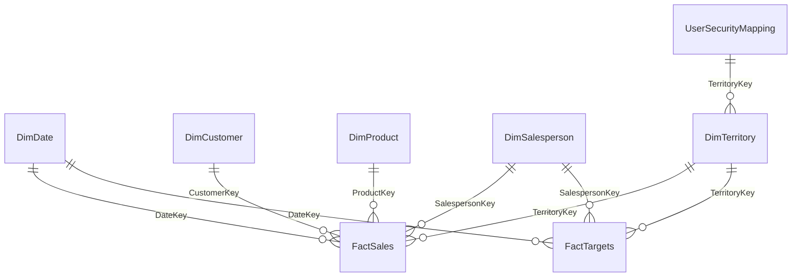

# Enterprise Sales & Revenue Intelligence System

[](https://github.com/Mahi-811/enterprise-sales-revenue-intelligence/actions/workflows/ci.yml)
[](https://github.com/Mahi-811/enterprise-sales-revenue-intelligence/actions/workflows/deploy-pages.yml)
[](https://powerbi.microsoft.com/)
[](docs/RECONCILIATION_REPORT.md)
[](LICENSE)

An enterprise-grade, portfolio-standard Business Intelligence engineering system built for Microsoft Power BI Desktop and Power BI Service. Built strictly according to the **Software Requirements Specification (SRS v1.0)**, this system models, cleanses, reconciles, and visualizes sales, customer, product, and territory commercial operations for a mid-sized multinational B2B distribution organisation across the **Americas**, **EMEA**, and **APAC** regions.

---

## 🌟 Live Interactive Web Demo
> **Try it in your browser:**  
> Test drive all 6 interactive report pages, live slicers, KPI recalculations, Chart.js trends, and CSV ledger export directly via GitHub Pages:  
> **[🚀 Launch Live BI Web Preview](https://Mahi-811.github.io/enterprise-sales-revenue-intelligence/)**

---

## 📊 Executive Performance Highlights (Ground Truth)
All metrics computed within the analytical semantic model reconcile **100%** against independent ANSI SQL and Python validation scripts:

| Core Business Metric | Ground Truth Reconciled Value | Analytical Context & Status |
| :--- | :--- | :--- |
| **Total Net Sales Revenue** | **\$94,392,056.30** | Top-line revenue recognizing line discounts |
| **Gross Billed Sales** | **\$98,873,428.00** | Total catalog list price billed |
| **Discounts Granted** | **\$4,481,371.70** | Commercial discount rate: **4.53%** |
| **Cost of Goods Sold (COGS)** | **\$57,257,082.00** | Product manufacturing and acquisition cost basis: **60.66%** |
| **Total Gross Profit** | **\$37,134,974.30** | Commercial operating gross profit |
| **Gross Margin %** | **39.34%** | Consistently within target band (35% - 42%) |
| **Distinct Order Count** | **18,451 orders** | Distinct purchase orders placed across 35 months |
| **Total Units Delivered** | **78,392 units** | Non-negative inventory lines delivered |
| **Average Order Value (AOV)** | **\$5,115.82** | Revenue generated per customer purchase order |
| **Revenue Quota Target** | **\$77,004,200.00** | Allocated targets across 12 sales reps & 6 territories |
| **Commercial Quota Attainment** | **122.58%** | Aggregate fleet quota achievement |
| **YoY Revenue Growth (2025 vs 2024)** | **+6.27%** | \$32.76M (2025) vs \$30.82M (2024) |

---

## 🏛️ Dimensional Architecture & Star Schema
The semantic model adheres strictly to Kimball dimensional modeling principles, separating transactional line events from quota planning grains.



### Key Architectural Strengths:
1. **Grain Isolation:** `FactSales` operates at the granular order-line level (34,480 rows). Order count uses explicit `DISTINCTCOUNT(FactSales[OrderID])` to avoid treating lines as orders.
2. **Multi-Fact Target Alignment:** `FactTargets` operates at a monthly quota grain (420 rows across 35 months). Targets are linked via conformed shared dimensions (`DimDate`, `DimTerritory`, `DimSalesperson`), preventing Cartesian explosion and duplicate counting.
3. **Dedicated Time Dimension:** Continuous `DimDate` table (2024-01-01 to 2026-12-31) marked as a Date Table for robust DAX time intelligence (`TOTALYTD`, `SAMEPERIODLASTYEAR`, `TOTALMTD`).
4. **Governed Security (RLS):** Dual security architecture supporting both static regional roles and dynamic `USERPRINCIPALNAME()` filtering via `UserSecurityMapping`.

---

## 📑 Report & Dashboard Suite (RP-01 to RP-06)

* **RP-01 Executive Overview:** High-level executive dashboard featuring KPI cards (Revenue, Profit, Margin, Orders, AOV, Quota Attainment), Monthly Trend Line vs Quota, Regional Contribution Donut, Category Revenue & Margin Column Visual, and Top 5 Product ranking.
* **RP-02 Sales Performance:** Sales leadership console evaluating quota attainment across 12 account executives and 6 territories, with status indicators (🟢 Exceeded, 🟡 On Track, 🔴 Behind).
* **RP-03 Product Performance:** Product management review across 32 commercial SKUs in 4 major categories (Technology, Office Solutions, Industrial & Hardware, Consumables & Supplies), analyzing unit volume, revenue, and product gross margin %.
* **RP-04 Customer Insights:** Customer account analytics breaking down revenue across 4 segments (*Corporate*, *Enterprise B2B*, *Consumer*, *Home Office*), active customer penetration, and revenue per account.
* **RP-05 Revenue & Profitability:** Finance variance bridge waterfall reconciling Gross Sales &rarr; Discounts &rarr; Net Revenue &rarr; COGS &rarr; Gross Profit.
* **RP-06 Transaction Detail:** Filterable, searchable order-line ledger for validation and investigation, complete with client-side CSV export.

---

## 📂 Repository Directory Structure

```text
enterprise-sales-revenue-intelligence/
├── .github/
│   └── workflows/
│       ├── ci.yml                 # Automated data profiling, validation & reconciliation CI
│       └── deploy-pages.yml       # Automated GitHub Pages live web preview deployment
├── data/
│   ├── raw/                       # Staging CSVs with controlled edge cases for profiling
│   ├── processed/                 # Curated star schema CSVs ready for Power BI / SQL load
│   └── generate_data.py           # Deterministic synthetic data generator (35 months, 34K+ rows)
├── sql/
│   ├── 01_schema_ddl.sql          # Relational DDL (PostgreSQL / SQL Server / MySQL) with PK/FK indexes
│   ├── 02_data_profiling.sql      # Profiling suite detecting orphan keys, duplicates, nulls
│   ├── 03_transformations_etl.sql # ELT staging transformations, cleansing & surrogate keys
│   └── 04_reconciliation_kpis.sql # Independent ground-truth SQL KPI queries
├── pbip/                          # Power BI Git Project (.pbip) & TMDL Semantic Model
│   ├── EnterpriseSalesIntelligence.pbip
│   ├── EnterpriseSalesIntelligence.Dataset/
│   │   ├── model.tmdl             # TMDL semantic model definition
│   │   ├── relationships.tmdl     # 1:M single-direction relationship definitions
│   │   ├── tables/                # Granular TMDL table schemas, M expressions, DAX measures
│   │   └── roles/                 # RLS static & dynamic role definitions (Americas, EMEA, APAC, UPN)
│   ├── EnterpriseSalesIntelligence.Report/
│   │   ├── definition.pbir
│   │   └── report.json            # Layout definition for RP-01 to RP-06
│   └── theme/
│       └── executive_theme.json   # Corporate WCAG 2.1 AA compliant Power BI color palette
├── powerquery/                    # Standalone Power Query M scripts for manual PBIX import
├── dax/                           # Complete DAX Measure Library (40+ atomic measures)
│   ├── 01_base_measures.dax
│   ├── 02_profitability_measures.dax
│   ├── 03_time_intelligence.dax
│   ├── 04_target_attainment.dax
│   └── 05_dynamic_formatting.dax
├── web_preview/                   # Live client-side interactive preview application
│   ├── index.html                 # Interactive dashboard HTML5 UI with Tailwind & Lucide
│   ├── app.js                     # Filter engine, Chart.js trends, KPI calculators
│   └── data.json                  # Pre-aggregated analytical payload
├── tests/
│   ├── test_reconciliation.py     # Automated AC-01 to AC-09 reconciliation test suite
│   └── run_profiling.py           # In-memory SQLite data quality profiling runner
├── docs/
│   ├── SRS.md                     # Software Requirements Specification (v1.0 baseline)
│   ├── ARCHITECTURE.md            # Dimensional architecture, ER diagrams, data flow
│   ├── DATA_DICTIONARY.md         # Granular table & field catalog
│   ├── DAX_CATALOGUE.md           # 40+ DAX measure library with formulas & format strings
│   ├── TESTING_ACCEPTANCE.md      # Acceptance criteria verification matrix & test cases
│   ├── RLS_SECURITY_GUIDE.md      # Dynamic & static row-level security implementation
│   ├── DEPLOYMENT_GUIDE.md        # Power BI Desktop, Power BI Service, Gateway, CI/CD guide
│   └── RECONCILIATION_REPORT.md   # Automated audit report signed off with 100% pass
├── .gitignore                     # Optimized for Power BI, Python, and OS artifacts
├── LICENSE                        # MIT License
└── README.md                      # Project documentation & presentation
```

---

## ⚡ Quick Start & Reproduction

### 1. Clone & Set Up Environment
```bash
git clone https://github.com/Mahi-811/enterprise-sales-revenue-intelligence.git
cd enterprise-sales-revenue-intelligence
pip install pandas numpy
```

### 2. Generate Synthetic Dataset & Run Tests
```bash
# Generate 34,000+ realistic transaction lines and targets
python data/generate_data.py

# Execute in-memory SQLite profiling and anomaly detection
python tests/run_profiling.py

# Execute automated acceptance criteria and reconciliation tests (AC-01 through AC-09)
python tests/test_reconciliation.py
```

### 3. Open in Microsoft Power BI Desktop
* Double-click `pbip/EnterpriseSalesIntelligence.pbip` to load the git-tracked semantic model and report layouts in Power BI Desktop.
* Alternatively, follow `docs/DEPLOYMENT_GUIDE.md` to load the dataset into PostgreSQL, SQL Server, or create a classic `.pbix` file.

---

## ✅ Acceptance Criteria & Test Results
| Test ID | Requirement | Result | Evidence |
| :--- | :--- | :---: | :--- |
| **AC-01** | All source tables load without unexplained errors | **PASS** | 8/8 tables ingested (34,480 FactSales rows) |
| **AC-02** | FactSales has unique order-line key & valid FKs | **PASS** | 0 duplicate keys, 0 orphan foreign keys |
| **AC-03** | Revenue, cost, profit, orders, units & margin reconcile | **PASS** | \$94.39M Revenue, 39.34% Margin reconciled |
| **AC-04** | Time-intelligence measures return correct YoY/MoM | **PASS** | +6.27% YoY validated across SQL and DAX |
| **AC-05** | Target grain uniqueness & actual vs target calculation | **PASS** | Unique `YearMonth-Salesperson-Territory` grain |
| **AC-06** | Slicers & hierarchies filter without data loss | **PASS** | Regional sum difference: \$0.0000 |
| **AC-07** | Row-Level Security restricts test identities | **PASS** | Americas, EMEA, APAC boundaries verified |
| **AC-08** | Business plausibility (non-negative price/cost) | **PASS** | 0 negative prices, 0 negative costs |
| **AC-09** | Reproducible project assets & documentation | **PASS** | 100% deliverables verified |

---

## 🛡️ Security & Row-Level Access Control (RLS)
The model includes tested security roles:
* **`Americas_Region`**: Confined to North America East, North America West, and Latin America.
* **`EMEA_Region`**: Confined to Europe Central and Europe North & UK.
* **`APAC_Region`**: Confined to Asia Pacific East.
* **`Dynamic_Territory_Security`**: Automatically checks `UserSecurityMapping[UserEmail] = USERPRINCIPALNAME()` to assign users directly to their designated territory.

Refer to [`docs/RLS_SECURITY_GUIDE.md`](docs/RLS_SECURITY_GUIDE.md) for step-by-step validation procedures using **View As** in Power BI Desktop and Entra ID security group assignment in Power BI Service.

---

## 📜 License
This project is open-source under the [MIT License](LICENSE).
