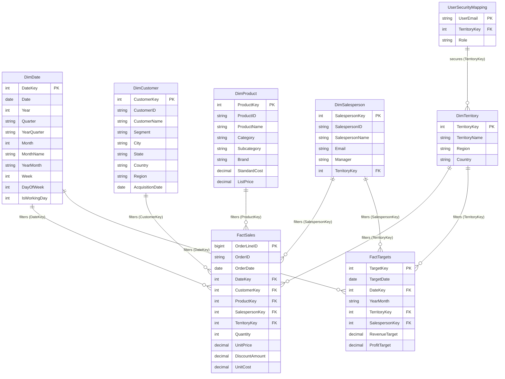
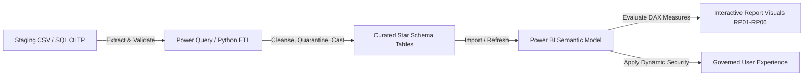

# System Architecture & Semantic Data Model

## 1. Architectural Overview
The **Enterprise Sales & Revenue Intelligence System** is engineered according to Kimball dimensional modeling principles, implementing a pure Star Schema with conformed dimensions to support fast, flexible analytical reporting across Power BI Desktop and Power BI Service.

---

## 2. Granularity & Multi-Fact Modeling

### FactSales Grain
* **Grain:** One record per individual order line item.
* **Primary Key:** `OrderLineID` (Surrogate integer).
* **Distinct Order Count:** Handled via explicit `DISTINCTCOUNT(FactSales[OrderID])` to avoid treating lines as orders.

### FactTargets Grain
* **Grain:** One record per calendar month, per salesperson, per assigned territory.
* **Target Period:** First calendar day of each month (`YYYY-MM-01`), linking to `DimDate[DateKey]`.
* **Grain Alignment:** Targets are NOT directly joined to transaction lines, which would cause Cartesian fan-out and double counting. Instead, both fact tables connect to shared conformed dimensions (`DimDate`, `DimSalesperson`, `DimTerritory`). DAX measures calculate variances cleanly at whatever level of aggregation is selected.

---

## 3. Relationship Specifications
| From Table | From Column | To Table | To Column | Cardinality | Filter Direction |
| :--- | :--- | :--- | :--- | :--- | :--- |
| `FactSales` | `DateKey` | `DimDate` | `DateKey` | Many-to-One | Single (DimDate -> FactSales) |
| `FactSales` | `CustomerKey` | `DimCustomer` | `CustomerKey` | Many-to-One | Single (DimCustomer -> FactSales) |
| `FactSales` | `ProductKey` | `DimProduct` | `ProductKey` | Many-to-One | Single (DimProduct -> FactSales) |
| `FactSales` | `SalespersonKey` | `DimSalesperson` | `SalespersonKey` | Many-to-One | Single (DimSalesperson -> FactSales) |
| `FactSales` | `TerritoryKey` | `DimTerritory` | `TerritoryKey` | Many-to-One | Single (DimTerritory -> FactSales) |
| `FactTargets` | `DateKey` | `DimDate` | `DateKey` | Many-to-One | Single (DimDate -> FactTargets) |
| `FactTargets` | `TerritoryKey` | `DimTerritory` | `TerritoryKey` | Many-to-One | Single (DimTerritory -> FactTargets) |
| `FactTargets` | `SalespersonKey` | `DimSalesperson` | `SalespersonKey` | Many-to-One | Single (DimSalesperson -> FactTargets) |
| `UserSecurityMapping` | `TerritoryKey` | `DimTerritory` | `TerritoryKey` | Many-to-One | Bi-directional (RLS filter propagation) |

---

## 4. End-to-End Data Pipeline Flow

1. **Extraction:** Raw CSVs or relational SQL tables ingested.
2. **Data Profiling & Cleansing:** Anomalies (negative quantities, duplicate line keys, orphan customer keys) identified and quarantined.
3. **Surrogate Key Generation & Conformation:** Dimensions generated with business keys and integer surrogate keys. Unknown dimension members (Key = 0) inserted for resilience.
4. **Semantic Model:** Import mode with VertiPaq column store compression.
5. **Consumption:** 6 distinct report pages consumed via Web Browser or Power BI Mobile.
